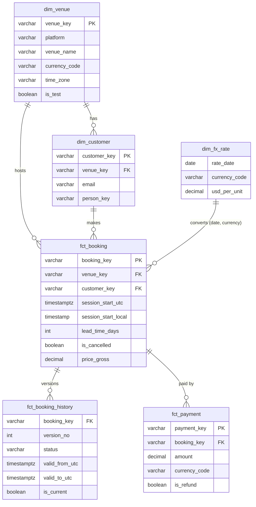

# Fernhill Leisure Group – One Warehouse, Two Booking Platforms

A small data warehouse that combines **Hopscotch** (online bookings) and **Apex** (go-kart venue software) into one model, built with **DuckDB + SQL** and a short Python runner, using a **medallion architecture** (bronze → silver → gold).

## How to run

Requirements: Python 3.9+.

```bash
pip install -r requirements.txt
python run.py
```

That single command:
1. rebuilds `warehouse.duckdb` from scratch out of the CSVs in `data/`
2. runs the data quality checks and **stops with an error if any fail**
3. runs the four business questions, prints them, and saves them to `output/*.csv` and `output/answers.md`

To explore afterwards, open `warehouse.duckdb` in DBeaver or the DuckDB CLI (`duckdb warehouse.duckdb`). Close it before running `run.py` again, because DuckDB allows only one writer.

## Repository layout

```
data/                       source CSVs, exactly as provided
sql/01_bronze.sql           raw load
sql/02_silver.sql           clean, type, de-duplicate (per source)
sql/03_gold.sql             unified model (dims + facts)
sql/04_checks.sql           data quality checks (one view per check)
sql/answers/q1..q4.sql      business questions
run.py                      one-command build
output/                     generated results (git-ignored)
```

---

## 1. The model

### Medallion layers

| Layer | Schema | What happens there |
|---|---|---|
| **Bronze** | `bronze` | Each CSV loaded **as text, unchanged**, plus `_source_file` and `_loaded_at`. It always matches the source, so silver can be rebuilt if a cleaning rule changes. |
| **Silver** | `silver` | Still one table per source table, but typed, **de-duplicated**, renamed consistently, with units fixed (Apex cents → major units, Hopscotch IN/OUT → signed amounts) and emails cleaned (placeholders → NULL). |
| **Gold** | `gold` | One **platform-neutral** star schema. Analysts query bookings, payments, venues and customers without knowing which system a row came from. |

### Gold tables

| Table | Grain (one row = …) | Primary key | Joins to |
|---|---|---|---|
| `dim_venue` | a venue (Hopscotch operator or Apex site) | `venue_key` | – |
| `dim_customer` | a customer record at one venue | `customer_key` | `dim_venue` via `venue_key` |
| `fct_booking` | a booking, in its **current** state | `booking_key` | `dim_venue`, `dim_customer` |
| `fct_booking_history` | a **version** of a booking (SCD type 2) | `booking_key` + `version_no` | `fct_booking` |
| `fct_payment` | a money movement (in or out) | `payment_key` | `fct_booking` (and `dim_venue`) |
| `dim_fx_rate` | a calendar day × currency | `rate_date` + `currency_code` | `fct_booking.session_date_local` + `currency_code` |
| `audit_unmatched_payments` | a payment whose booking doesn't exist | `payment_key` | – (kept for investigation) |



### Keys that are unique across both sources

Every key is the **platform prefix + the source's natural key**: `HOP-8800001`, `APX-3-57`.

Each Apex site runs its own database, so its numbers only mean something within that site (ticket `1` exists at several sites). Apex keys therefore always include the site: `APX-<site>-<ticket>`. The keys stay readable and traceable back to the source; in a larger system they could be hashed (`md5('apex|3|57')`) with no change to the design.

### How the platform differences are handled

| Topic | Hopscotch | Apex | Gold |
|---|---|---|---|
| Bookings | reservation versions | tickets | `fct_booking` (current) + `fct_booking_history` (versions) |
| Cancellation | latest version `CANCELLED` | `outcome = WITHDRAWN` | `is_cancelled`, `cancelled_at_utc` |
| Money sign | always positive + `direction` | negative = refund | `amount` signed: + received, − refunded |
| Money units | major units | tickets in **cents**, settlements in major units | major units everywhere |
| Time | UTC | site local time, no offset | every event in **both** `*_utc` and `*_local` |
| Currency | per operator | per site | local currency kept; USD via `dim_fx_rate` |
| Customers | patron per operator | profile per site | `dim_customer` per venue + `person_key` across venues/platforms |
| Test venues | `is_sandbox = true` | `is_training = 1` | `dim_venue.is_test` |

Time-zone conversion uses the IANA zone of the venue, so daylight saving time (and its absence, as in Phoenix) is handled correctly. This matters: **34 bookings fall in a different month in UTC than in local time**. For example, a 10:30 am climb in Sydney on 1 January 2025 is still 31 December 2024 in UTC, and an 8 pm race in Phoenix on 31 December 2024 is already 2025 in UTC. Using UTC would put these bookings in the wrong month, and even the wrong year.

`run.py` sets the session time zone to UTC so results are the same on every machine. When you browse `*_utc` columns in DBeaver, they may display in your own computer's time zone.

### Keeping history

- **Hopscotch** writes a full new version on every change, so every version is loaded into `fct_booking_history` as an SCD2 row (`valid_from_utc`, `valid_to_utc` = start of the next version, `is_current`).
- **Apex** only keeps the latest state. From the data available I rebuild two versions: *opened* (CONFIRMED) and, if applicable, *withdrawn* (CANCELLED). In production, Apex history would come from **snapshotting** each daily extract and opening a new SCD2 row whenever a row's hash changes.
- Bronze is designed to be **append-only** in production (every load is kept with `_loaded_at`), so any past state can be reconstructed.

### Data quality checks

`sql/04_checks.sql` defines each check as a view that returns the rows breaking an assumption. `run.py` discovers them automatically.

- **`dq.*` (fail the build):** keys unique; duplicates in the source are exact copies, not conflicting; no rows lost bronze → silver except exact duplicates; every booking has a customer at the same venue; payment and booking currency = venue currency; **money reconciles** (silver total = gold payments + audited unmatched); unmatched payments < 1%; every activity date has an FX rate and no fill-forward exceeds 5 days; Hopscotch versions have no gaps; no booking is reinstated after cancellation; Apex `WITHDRAWN` ⇔ withdrawn time present; no booking is made after its activity date; no unexpected codes (direction, status, payment method, currency).
- **`dq_warn.*` (reported, handled):** exact duplicates removed, unmatched payments, customers without a usable email.

---

## 2. Answers

All answers exclude test and demo venues (`Demo Venue - DO NOT USE`, `TRAINING TRACK`). The full results are in `output/` after a run.

### Q1. Net takings in USD by venue and month (2025) — [`q1_net_takings_by_venue_month.sql`](sql/answers/q1_net_takings_by_venue_month.sql)

Net takings = sum of signed payments (tax included), placed in the month of the **activity** in venue local time, converted at the rate for the activity date. The weekend/holiday rate is the last published one, and USD = 1. **Cancelled bookings are included**, because retained deposits and cancellation fees are real takings, while fully refunded bookings net to zero. Rounded to whole USD below; the CSV output also has collected and refunded amounts to the cent.

| Platform | Venue | Jan | Feb | Mar | Apr | May | Jun | Jul | Aug | Sep | Oct | Nov | Dec | **2025** |
|---|---|---:|---:|---:|---:|---:|---:|---:|---:|---:|---:|---:|---:|---:|
| Apex | Bayside Karting Melbourne | 9,500 | 10,150 | 6,619 | 3,850 | 6,476 | 6,286 | 6,039 | 6,795 | 8,001 | 6,965 | 6,722 | 8,732 | **86,135** |
| Apex | Desert Speedway Phoenix | 9,236 | 7,632 | 8,535 | 5,663 | 9,620 | 12,671 | 12,848 | 8,790 | 7,124 | 8,013 | 8,466 | 8,913 | **107,511** |
| Apex | Northern Karting Manchester | 10,294 | 7,503 | 11,942 | 10,624 | 15,256 | 18,783 | 18,927 | 21,338 | 11,545 | 10,995 | 15,513 | 14,448 | **167,168** |
| Apex | Orlando Grand Prix Karting | 8,793 | 10,014 | 8,998 | 8,418 | 9,510 | 11,870 | 12,997 | 14,723 | 9,869 | 9,474 | 8,839 | 11,434 | **124,939** |
| Hopscotch | Barton Creek Kayak Tours | 5,236 | 1,875 | 9,816 | 7,875 | 10,347 | 14,645 | 12,311 | 13,969 | 11,239 | 11,126 | 4,389 | 5,059 | **107,887** |
| Hopscotch | Front Range Paintball | 17,539 | 14,242 | 20,969 | 15,070 | 10,707 | 20,852 | 20,595 | 23,379 | 13,333 | 15,921 | 14,179 | 15,934 | **202,720** |
| Hopscotch | Harbour Climb Sydney | 5,311 | 4,817 | 3,661 | 2,697 | 3,088 | 3,239 | 3,256 | 4,704 | 3,578 | 3,194 | 3,221 | 5,139 | **45,905** |
| Hopscotch | Liffey Axe Club | 10,138 | 12,058 | 10,994 | 12,036 | 12,998 | 13,647 | 13,348 | 20,147 | 11,918 | 13,501 | 11,642 | 13,360 | **155,787** |
| Hopscotch | Locked In Leeds | 9,099 | 9,169 | 8,123 | 9,714 | 9,545 | 9,771 | 12,324 | 12,098 | 7,200 | 8,129 | 8,615 | 7,685 | **111,472** |

Total across all venues: **$1,109,517.26**.

### Q2. Cancellation rate by platform and lead time — [`q2_cancellation_rate_by_lead_time.sql`](sql/answers/q2_cancellation_rate_by_lead_time.sql)

Lead time = activity date − booking date, both as **local calendar dates**. Population: bookings with activity in 2025.

| Platform | Lead time | Bookings | Cancelled | Rate |
|---|---|---:|---:|---:|
| Apex | Same day | 679 | 11 | 1.6% |
| Apex | 1–7 days | 1,372 | 85 | 6.2% |
| Apex | 8–30 days | 983 | 109 | 11.1% |
| Apex | 31+ days | 417 | 66 | 15.8% |
| **Apex** | **All** | **3,451** | **271** | **7.9%** |
| Hopscotch | Same day | 702 | 16 | 2.3% |
| Hopscotch | 1–7 days | 1,495 | 117 | 7.8% |
| Hopscotch | 8–30 days | 1,068 | 160 | 15.0% |
| Hopscotch | 31+ days | 409 | 91 | 22.2% |
| **Hopscotch** | **All** | **3,674** | **384** | **10.5%** |

The further ahead a booking is made, the more likely it is to be cancelled, on both platforms. Hopscotch cancels more than Apex in every bucket.

### Q3. Busiest hour per venue (local time, non-cancelled, 2025) — [`q3_busiest_hour_by_venue.sql`](sql/answers/q3_busiest_hour_by_venue.sql)

| Platform | Venue | Busiest hour | Bookings | Share of venue's bookings |
|---|---|---|---:|---:|
| Apex | Bayside Karting Melbourne | 15:00 | 180 | 26.9% |
| Apex | Desert Speedway Phoenix | 20:00 | 234 | 30.3% |
| Apex | Northern Karting Manchester | 18:00 | 221 | 27.7% |
| Apex | Orlando Grand Prix Karting | 19:00 | 258 | 27.4% |
| Hopscotch | Barton Creek Kayak Tours | 09:00 | 165 | 27.8% |
| Hopscotch | Front Range Paintball | 13:00 | 146 | 27.7% |
| Hopscotch | Harbour Climb Sydney | 17:00 | 175 | 25.1% |
| Hopscotch | Liffey Axe Club | 20:00 | 209 | 31.4% |
| Hopscotch | Locked In Leeds | 19:00 | 222 | 27.5% |

`rank()` is used so ties would all be shown; there are none.

### Q4. Shared customers in 2025 — [`q4_shared_customers.sql`](sql/answers/q4_shared_customers.sql)

| Measure | Counting all bookings | Non-cancelled bookings only |
|---|---:|---:|
| People who booked in 2025 | 4,101 | 3,858 |
| **Booked at more than one venue** | **563** | 504 |
| **Booked on both Hopscotch and Apex** | **417** | 375 |

**How two records are judged to be the same person:** they have the same email after lower-casing and trimming. Placeholder emails (`noemail@apexvenue.invalid`, 193 records; `none@none.com`, 17) and blanks are excluded, because otherwise hundreds of strangers would merge into one "person". Names are not used to merge: two records with the same name but different emails stay separate. I checked that no cleaned email is shared by two different names, so email is a safe key here. The 429 records with no usable email can't be matched, so **these counts are a lower bound**.

---

## 3. Write-up

### The data: problems found and decisions

| Problem | Decision |
|---|---|
| 40 exact duplicate rows in `reservation_versions`, 18 in Apex `settlements` | Keep one per natural key in silver. A check fails if any duplicates *differ* in content, because then we couldn't know which one is right. Without this, takings would be double-counted. |
| 10 payments (6 Hopscotch, 4 Apex) reference bookings that don't exist; they're round amounts at round times, probably manual or test entries | Not loaded into `fct_payment`, since they have no venue or activity month. They are kept in `gold.audit_unmatched_payments` and reported on every run, and the build fails if they exceed 1% of payments. |
| Placeholder and missing emails; inconsistent case and whitespace (923 Apex, 253 Hopscotch) | Normalise the emails, turn placeholders into NULL, and never match people on them. |
| Apex ticket values in cents while settlements are in major units | Converted to major units in silver. |
| Opposite sign conventions for refunds | Converted to one signed `amount`. |
| UTC vs local time | Both stored; all "which month / which hour / which day" logic uses venue local time (34 bookings change month depending on which is used). |
| FX published on business days only; no USD row | Fill forward from the last published rate (checked never to exceed 5 days); USD = 1. |
| Test venues | Flagged `is_test` in `dim_venue` and excluded from every answer. |

**Assumptions:**
- Money is attributed to the booking's activity month even when it moved earlier (deposit) or later (refund).
- Cancelled bookings count towards takings, because retained fees are revenue.
- Cancellation means the *current* state is cancelled; the data has no reinstatement after cancellation, and a check enforces this.
- "Booked in 2025" in Q4 means having an activity in 2025.
- For the rare local times that fall in a daylight-saving changeover hour, DuckDB's standard resolution is used.

### Production

**Getting data out without hurting the application databases.** I'd never query the primary databases directly. For Hopscotch's hundreds of identical operator databases, I'd use **change data capture** (for example Debezium or native logical replication) reading the transaction log, or failing that, incremental queries against **read replicas**. The changes would land as files in object storage (S3/GCS), partitioned by `source / operator / date`. Apex sites are often on-premise, so a small agent at each site would push incremental extracts (by ID or updated-at watermark), or CDC where possible, outside peak hours, with retries and back-off.

**Incremental loading and late or changed records.** Bronze is append-only: every extract is kept with its load time, so loads can be replayed. Silver uses `MERGE` on the natural key, keeping the latest version, with a **look-back window** (re-processing the last N days) to catch late-arriving rows. Gold rebuilds only the partitions that changed, using activity month as the partition. A late refund for a March booking re-computes March. Hopscotch versions append naturally; Apex gets SCD2 through snapshot and hash comparison. In practice I'd move this to **dbt** (incremental models, snapshots, tests) with an orchestrator such as Airflow or Dagster.

**Schema changes.** Bronze lands schema-on-read, so a new column doesn't break the load. Each source has a **data contract** listing expected columns and types. A new or removed column, or a type change, raises an alert and is mapped deliberately in silver before it reaches gold. Checks like `unexpected_code_values` catch new enum values before they fall silently through `CASE` statements. Because all Hopscotch databases share one schema, I'd track a schema version per operator and roll out changes per operator.

**Personal data and deletion requests.** I'd keep PII (names, emails) in a small number of restricted tables (`dim_customer`, and the bronze and silver patron and profile tables), with column-level access control and masking for most analysts. Facts carry only surrogate keys. Matching would use a **salted hash** of the email (`person_key`), so analysts can count shared customers without seeing emails. For a deletion request, I'd record it in a deletion register, then delete or blank the person's PII in bronze, silver and gold and re-run the identity step. Facts stay, keyed by an anonymous surrogate, so totals remain correct. Bronze retention would be limited, and backups would expire within the legal window. An alternative is **crypto-shredding**: PII encrypted with a per-person key that is destroyed on request.

**Monitoring and alerting.**
- **Freshness per source and per operator/site:** with hundreds of sources, one operator silently stopping is the likeliest failure.
- **Row-volume anomalies** compared with the same weekday last week.
- **All `dq.*` checks**, failing the pipeline before gold is published.
- **Rate of unmatched payments** and money **reconciliation** against source totals.
- **Missing FX rates.**
- **Pipeline duration and cost.**
- **Schema-drift alerts.**

### What I'd do next with more time

- Move the SQL to dbt models with built-in tests and documentation, and add CI (GitHub Actions running `python run.py` on every push).
- Add `dim_date` and `dim_product`.
- Improve identity resolution beyond exact email (for example phone number, or fuzzy name plus email-domain rules) with a confidence score.
- Confirm business rules with the finance team: whether takings should exclude tax, and whether payment-date FX would be preferred.

---

## How I used AI

All of the code and documentation in this repository were written by an AI assistant (Claude). I chose this so I could reach a working, end-to-end understanding of the exercise quickly and spend my time on the design and data decisions rather than on boilerplate. Before involving the AI, I investigated the raw data by hand in DuckDB/DBeaver. That surfaced the issues the solution had to handle: duplicate reservation versions and settlements, payments with no matching booking, placeholder and inconsistently formatted emails, test and demo venues, Apex ticket values in cents while settlements are in major units, exchange rates missing on weekends with no USD row, and the difference between Hopscotch’s UTC timestamps and Apex’s local times. I then gave the AI clear instructions on the end result I needed, the issues to handle, and how to build it: a medallion bronze → silver → gold architecture in DuckDB, layers kept separate, loud data quality checks, and a reproducible one-command run. I reviewed the logic in detail, including the time-zone conversions, the email-based identity matching and its hashing, and the SCD2 history built with lead() window functions, until I could explain and defend every decision.
